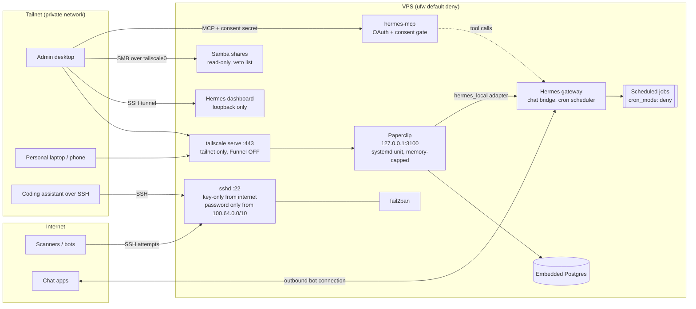

# Architecture

## Overview

One Ubuntu 24.04 VPS, reachable only over a Tailscale network (a "tailnet") for everything except SSH. All hostnames and addresses below are placeholders.

| Component | Role | Listens on | Reachable from |
|---|---|---|---|
| Hermes gateway | Agent runtime. Bridges chat apps, runs scheduled jobs, hosts `hermes_local` for Paperclip agents | outbound only | n/a |
| hermes-mcp | MCP server exposing Hermes tools to other clients, with its own OAuth server | two local ports | tailnet |
| Hermes dashboard | Admin UI | loopback | SSH tunnel only |
| Paperclip | Agent "company" control plane (issues, routines, approvals, embedded Postgres) | `127.0.0.1:3100` | tailnet, via `tailscale serve` |
| Samba | Read-only file shares for browsing from a desktop | 445 | tailnet interface only |
| sshd | Administration | 22 | internet (key only) and tailnet (key or password) |
| fail2ban | Bans repeated SSH failures | n/a | n/a |

Constraints that drove most decisions: under 4 GB of RAM, 2 cores, 4 GB swap, no builds on the box without asking, and an unauthenticated Paperclip UI (`local_trusted` mode) that controls agents with shell access.

## Diagram



## Trust boundaries

1. **Internet to VPS.** Only SSH is open, and only key authentication is accepted on the public route. `ufw` defaults to deny. Management ports for a self-hosted remote-desktop relay were restricted to the tailnet interface.
2. **Tailnet to VPS.** Tailnet membership is not treated as trust. Samba uses `hosts allow` per device and `valid users`. Paperclip, which has no login, is limited by a Tailscale ACL to a short list of personal devices. hermes-mcp requires a consent step with a secret.
3. **Agent to host.** Paperclip agents run with a shell (the completion contract requires an HTTP callback made with `curl`, so a terminal toolset is effectively mandatory). They cannot `sudo`, the service runs with `NoNewPrivileges=yes` and `ProtectSystem=full`, and its memory is capped by cgroup.
4. **Agent to outside world.** Anything customer-facing goes through a review stage restricted to humans. Agents draft; a person decides.

## How a unit of work flows

```
Goal
 `- Parent issue (a campaign or task)
     |- Child: gather inputs          (researcher agent)
     |- Child: draft output           (drafting agent)
     |- Child: review                 (QA agent, or a script for mechanical checks)
     |- Gate:  human approval         (review policy human_only; agents cannot pass it)
     `- Child: act on the result      (only after the gate)
```

- Parent/child issues and `blocks` relations express ordering.
- An issue execution policy attaches `review` and `approval` stages. With `human_only`, the assigned agent can complete its work but the issue parks in review until a person decides.
- Pausing or cancelling an issue tree is the per-project emergency stop. In testing, a child under a paused tree stayed `todo` and no run started.
- Heartbeats are off. Work is event-driven (assignment) plus a handful of routines, which keeps a small box idle most of the time.
- One behavior to design around: **a comment on a finished issue reopens it and wakes its assignee.** New questions go in new issues.

## Capacity

Measured, not estimated. With two agents assigned at the same instant:

| Metric | Observed |
|---|---|
| Paperclip service memory peak | about 1.1 GB, equal to the `MemoryHigh` soft cap |
| Throttle events | rose from 44 to 388 |
| Lowest system available memory | about 1.4 GB |
| `MemoryMax` hits / OOM kills | 0 / 0 |

Conclusion: two concurrent runs is the safe limit on this box, three risks the hard cap. Paperclip schedules different agents concurrently (`maxConcurrentRuns` is per agent), so the limit has to be enforced by design: few agents, heartbeats off, routines staggered.

## Network exposure, before and after

| Surface | Before | After |
|---|---|---|
| Agent dashboard | Public via Tailscale Funnel, started with an insecure flag | Loopback only, reached through an SSH tunnel |
| OAuth endpoints and MCP | Public via Funnel, open registration, auto-approve | Tailnet only, consent page requires a secret, redirect allowlist |
| Paperclip UI | Not reachable reliably, no persistence across reboot | Tailnet only through `tailscale serve`, ACL-restricted, persistent unit |
| File shares | Whole home directory, read/write | Purpose-specific shares, read-only, 15+ entry veto list |
| SSH | Password allowed everywhere | Key-only publicly, password only from the tailnet range |
| Remote-desktop relay ports | Open to the internet | Tailnet interface only |

## Verification

A short list of read-only checks (see [`examples/verify.sh`](../examples/verify.sh)) confirms the state after any change: unit enabled and active, health endpoint, no serve/Funnel config you did not intend, `PasswordAuthentication no`, lingering enabled, and two `curl` probes that should return 400 and 401.
